<div align="center">


# Pondera

**Tu promedio ponderado, claro y al día. Del ciclo 1 al 10.**

Aplicación móvil para estudiantes universitarios que calcula el promedio ponderado de cada curso,
ciclo y carrera, simula qué nota se necesita para aprobar y lee las notas del portal con la cámara.

<br>

[](https://flutter.dev)
[](https://dart.dev)
[](https://firebase.google.com)
[](https://developers.google.com/ml-kit/vision/text-recognition/v2)
[](https://m3.material.io)
[](#requisitos)
[](proyecto_moviles2_grupo03/test)

<br>


**Universidad Privada de Tacna** · Facultad de Ingeniería · Escuela Profesional de Ingeniería de Sistemas<br>
Curso **SI-988 Soluciones Móviles II** · **Grupo 03** · 2026

</div>

---

## Tabla de contenidos

- [Descripción](#descripción)
- [Características](#características)
- [Capturas de pantalla](#capturas-de-pantalla)
- [Identidad visual](#identidad-visual)
- [Arquitectura](#arquitectura)
- [Modelo de datos](#modelo-de-datos)
- [Cómo se calcula el promedio](#cómo-se-calcula-el-promedio)
- [Escáner de notas](#escáner-de-notas)
- [Tecnologías](#tecnologías)
- [Requisitos](#requisitos)
- [Instalación y ejecución](#instalación-y-ejecución)
- [Pruebas](#pruebas)
- [Estructura del repositorio](#estructura-del-repositorio)
- [Historias de usuario](#historias-de-usuario)
- [Flujo de trabajo del equipo](#flujo-de-trabajo-del-equipo)
- [Hoja de ruta](#hoja-de-ruta)
- [Equipo](#equipo)
- [Licencia](#licencia)

---

## Descripción

En la universidad cada curso se evalúa por **unidades** con distinto peso, y cada unidad por
**tipos de evaluación** (examen, laboratorio, proyecto, asistencia...) que a su vez tienen su propio
peso y pueden tener varias notas. Saber "cómo voy" exige hacer cálculos ponderados en varios niveles,
y el portal de notas suele mostrar un promedio que cuenta como cero lo que todavía no se ha evaluado.

**Pondera** resuelve eso:

- Registra la jerarquía completa **Ciclo → Curso → Unidad → Tipo de evaluación → Notas**.
- Calcula automáticamente la nota de cada unidad, de cada curso y el promedio del ciclo y el acumulado.
- Muestra el **promedio parcial** real (lo evaluado hasta hoy), sin contar como 0 lo pendiente.
- Simula **qué nota necesitas** en lo que falta para aprobar o llegar a tu meta.
- Lee el **reporte de notas del portal con la cámara** y lo convierte en datos, sin escribir a mano.
- Funciona también **sin cuenta**, como calculadora rápida.

La escala es vigesimal (0 a 20) y la nota mínima aprobatoria es **10.5**.

---

## Características

| Área | Qué hace |
|---|---|
| **Cuenta** | Registro e inicio de sesión con correo (Firebase Auth), **verificación de correo obligatoria**, recuperación de contraseña y modo sin cuenta. |
| **Calculadora rápida** | Promedio ponderado inmediato con componentes editables, indicador de suma de pesos (100 %) y opción de guardar los datos al crear una cuenta. |
| **Historial académico** | CRUD de ciclos, cursos, unidades, tipos de evaluación y notas, con borrado en cascada. |
| **Cálculo multinivel** | Promedio del tipo → nota de unidad → nota del curso → promedio del ciclo → acumulado. Avisa qué falta cuando la información está incompleta. |
| **Simuladores** | "¿Qué nota necesito?" por unidad y por curso: nota necesaria en lo pendiente, máximo alcanzable y metas imposibles. Tarjeta interactiva con el promedio proyectado. |
| **Escáner de notas** | Foto o captura del portal → recorte → reconocimiento de texto **en el dispositivo** → vista previa editable → guardado. Permite escanear por partes (una unidad por foto). |
| **Gráficos de evolución** | Línea de notas por unidad y barras comparando los cursos del ciclo, con la referencia de 10.5. |
| **Diseño** | Material 3, tema claro y oscuro, tipografía propia, estados aprobado/desaprobado siempre con ícono y texto, microinteracciones y accesibilidad (lectores de pantalla, áreas táctiles de 48 px). |
| **Seguridad** | Reglas de Firestore: cada usuario solo lee y escribe sus propios datos, y solo con el correo verificado. |

---

## Capturas de pantalla

<table>
  <tr>
    <td align="center">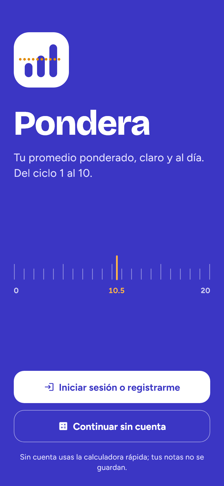<br><sub><b>Bienvenida</b></sub></td>
    <td align="center">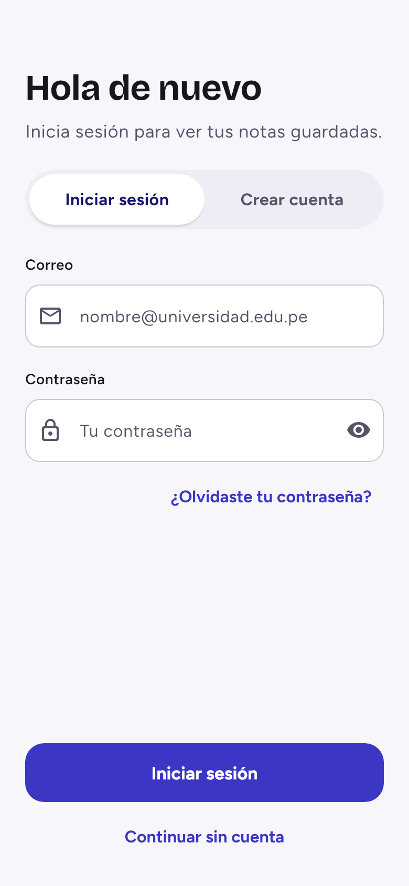<br><sub><b>Inicio de sesión</b></sub></td>
    <td align="center">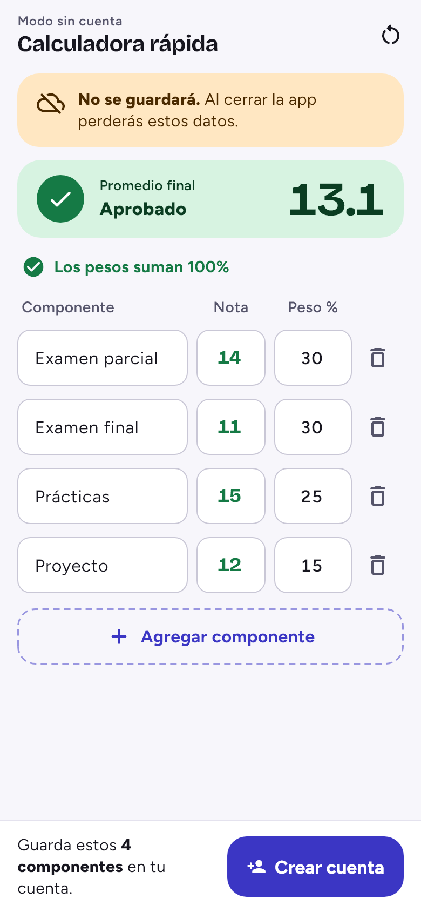<br><sub><b>Calculadora sin cuenta</b></sub></td>
    <td align="center">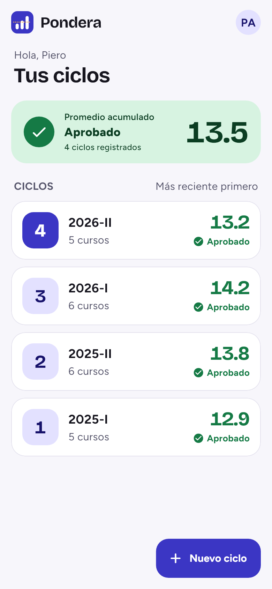<br><sub><b>Tus ciclos</b></sub></td>
  </tr>
  <tr>
    <td align="center">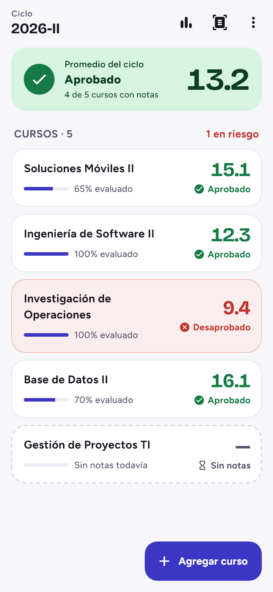<br><sub><b>Cursos del ciclo</b></sub></td>
    <td align="center">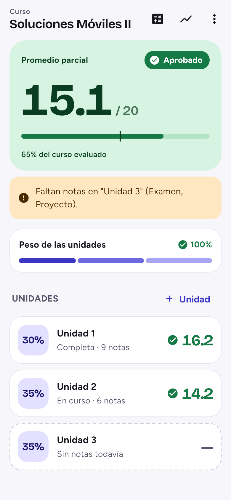<br><sub><b>Detalle del curso</b></sub></td>
    <td align="center">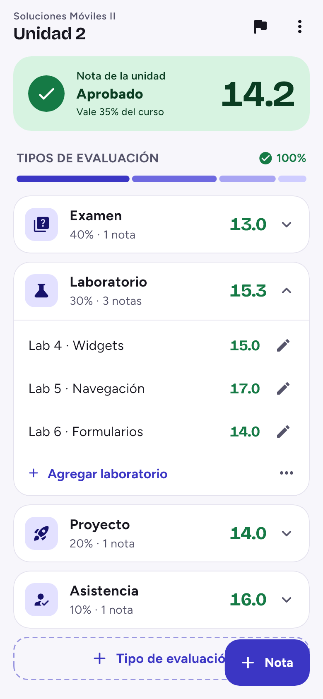<br><sub><b>Tipos de evaluación y notas</b></sub></td>
    <td align="center">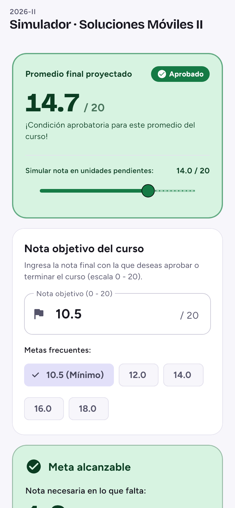<br><sub><b>Simulador del curso</b></sub></td>
  </tr>
  <tr>
    <td align="center">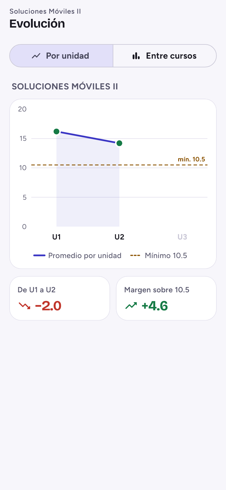<br><sub><b>Evolución por unidad</b></sub></td>
    <td align="center">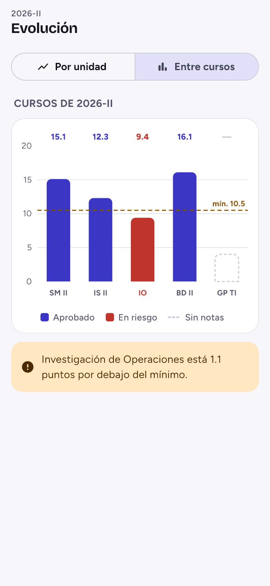<br><sub><b>Comparación entre cursos</b></sub></td>
    <td align="center">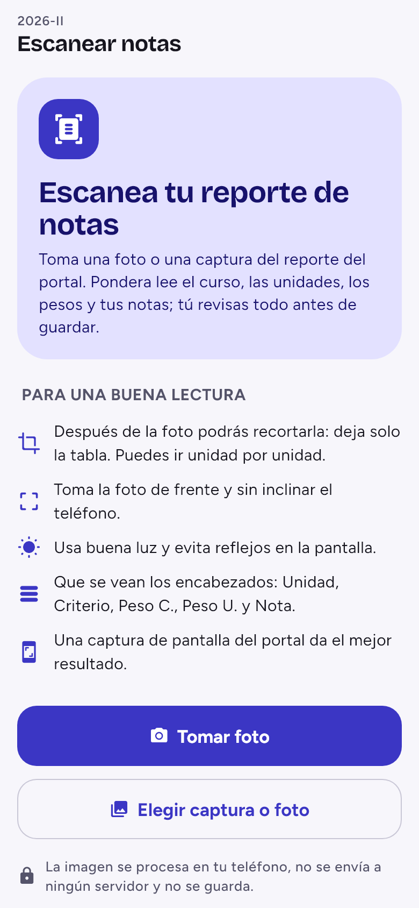<br><sub><b>Escáner de notas</b></sub></td>
    <td align="center">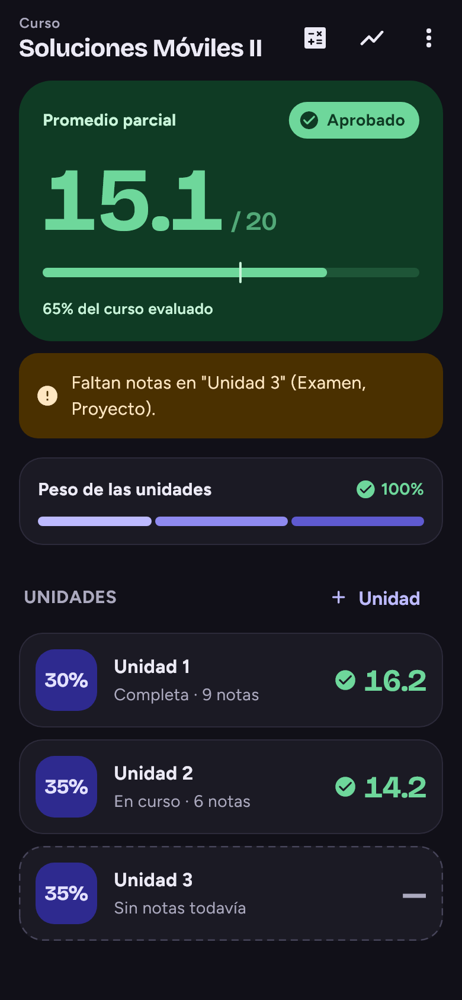<br><sub><b>Modo oscuro</b></sub></td>
  </tr>
</table>

<sub>Capturas generadas renderizando los widgets reales de la app con datos de ejemplo.</sub>

---

## Identidad visual

<table>
  <tr>
    <td align="center" width="180"><br><sub>Logo principal</sub></td>
    <td align="center" width="180">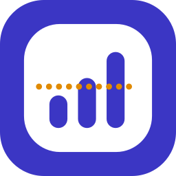<br><sub>Sobre fondo índigo</sub></td>
    <td>
      <b>El logo</b> es un cuadrado redondeado con <b>tres barras que suben</b> (el promedio que crece) y una
      <b>línea punteada ámbar a media altura</b>, que representa el umbral aprobatorio de 10.5 que la nota supera.
      En la app se dibuja con código (<code>PonderaLogo</code>) y se anima al abrir la pantalla de bienvenida.
    </td>
  </tr>
</table>

| Token | Claro | Oscuro | Uso |
|---|---|---|---|
| Primary |  |  | Marca, botones, acentos |
| Aprobado |  |  | Nota mayor o igual a 10.5 |
| Desaprobado |  |  | Nota menor a 10.5 |
| Aviso |  |  | Pesos incompletos, valores dudosos, metas inalcanzables |

- **Tipografía:** [Bricolage Grotesque](https://fonts.google.com/specimen/Bricolage+Grotesque) para títulos y notas (cifras tabulares) y [Figtree](https://fonts.google.com/specimen/Figtree) para el texto. Se distribuyen dentro de la app, sin depender de internet.
- **Regla de diseño:** el estado de una nota nunca se comunica solo con color; siempre lleva ícono y palabra ("Aprobado", "Desaprobado").

---

## Arquitectura

La app sigue una arquitectura por capas. Las pantallas no contienen fórmulas: la lógica de cálculo vive
en clases puras (sin Firebase) que se prueban con tests unitarios.

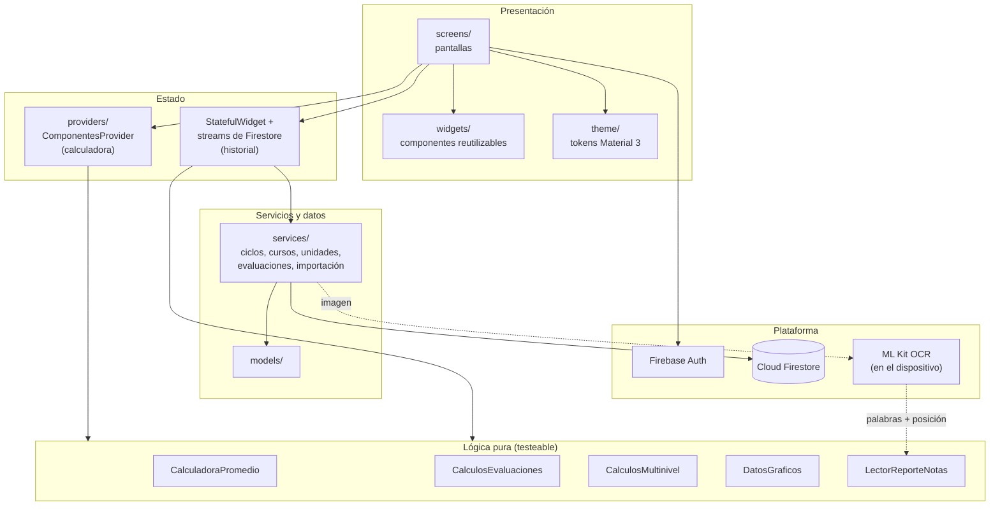

**Navegación principal**

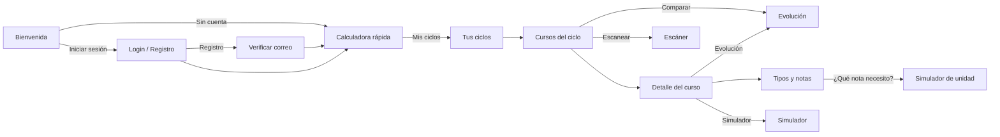

---

## Modelo de datos

Toda la información de un estudiante vive bajo su documento de usuario en Cloud Firestore.
Los ciclos y los cursos son colecciones hermanas (el curso guarda el `cicloId`) y, desde el curso
hacia abajo, los datos son subcolecciones.

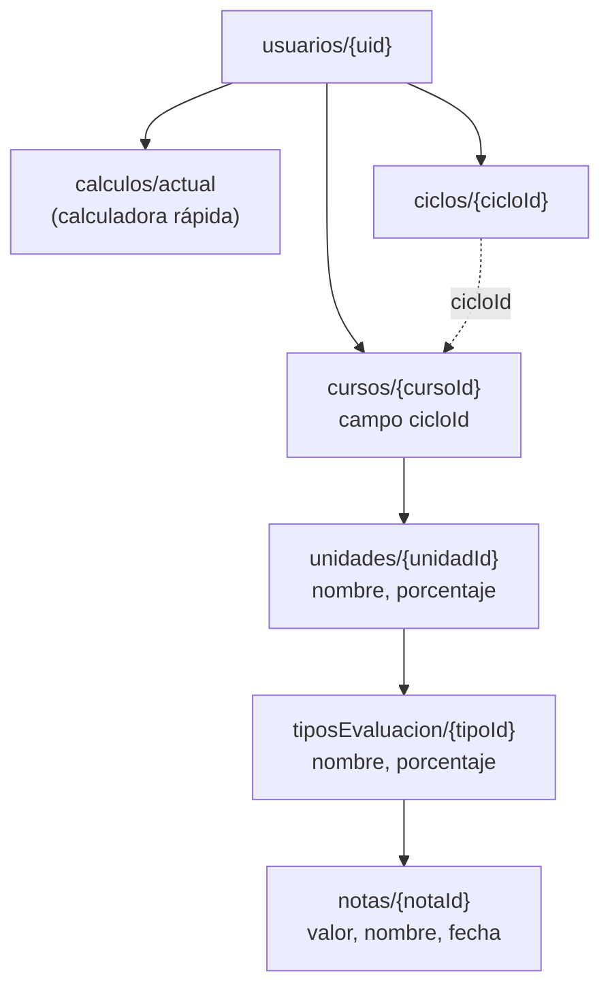

Detalle de campos en [`docs/MODELO_DATOS_FIRESTORE.md`](proyecto_moviles2_grupo03/docs/MODELO_DATOS_FIRESTORE.md)
y reglas de seguridad en [`firestore.rules`](proyecto_moviles2_grupo03/firestore.rules).

---

## Cómo se calcula el promedio

**1. Promedio de un tipo de evaluación** (por ejemplo, varios laboratorios):

$$\bar{x}_{tipo} = \frac{1}{n}\sum_{i=1}^{n} nota_i$$

**2. Nota de la unidad** (cada tipo con su peso dentro de la unidad):

$$nota_{unidad} = \sum_{tipos} \bar{x}_{tipo} \cdot \frac{peso_{tipo}}{100}$$

**3. Nota final del curso** (cada unidad con su peso dentro del curso), redondeada a 1 decimal:

$$nota_{curso} = \sum_{unidades} nota_{unidad} \cdot \frac{peso_{unidad}}{100}$$

**4. Promedio parcial.** Mientras faltan evaluaciones, Pondera no cuenta lo pendiente como 0, sino que
promedia solo lo evaluado:

$$parcial = \frac{\text{puntos obtenidos}}{\text{porcentaje evaluado} / 100}$$

> Ejemplo real: si en la Unidad 1 (30 %) tienes 14.5 y el resto aún no se evalúa, el portal muestra
> **4.35** ("promedio actual: 4"), mientras que Pondera muestra **14.5 con el 30 % del curso evaluado**.

**5. Simulador.** Nota necesaria en lo pendiente para llegar a una meta:

$$nota_{necesaria} = \frac{meta - \text{puntos obtenidos}}{\text{peso pendiente} / 100}$$

Si es mayor que 20 la meta es inalcanzable; si es 0 o menos, la meta ya está asegurada.

---

## Escáner de notas

El escáner convierte una foto o captura del reporte del portal en datos estructurados, **sin enviar la
imagen a ningún servidor**.

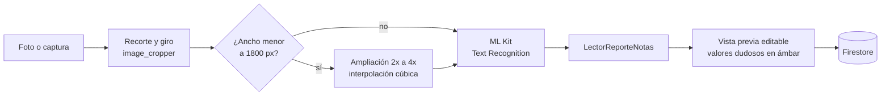

`LectorReporteNotas` es un lector especializado en el formato del reporte del portal:

- **Agrupa las filas siguiendo la inclinación local** de la foto, de modo que también funciona con perspectiva.
- **Usa anclas fijas** ("Unidad I", "Evaluacion 01") y la fila de encabezados para ubicar las columnas.
- **Reconoce cada dato por su forma**: peso (`15 %`), nota (0 a 20), fecha y hora (se descartan).
- **Tolera errores de OCR**: `Undad`, `Exaluscian`, `%` leído como `96`, `O` por `0`, notas pegadas a la fecha, palabras recortadas.
- **Aplica reglas del dominio**: numeración secuencial, deducción del único peso faltante para llegar a 100 % y nueva unidad cuando la numeración vuelve a "01".
- **Marca como dudoso** todo lo que tuvo que deducir, para que el usuario lo revise antes de guardar.

Está cubierto por pruebas con **lecturas reales de ML Kit** tomadas en un celular (`test/fixtures/`).

---

## Tecnologías

| Categoría | Tecnología | Versión | Uso |
|---|---|---|---|
| Framework | [Flutter](https://flutter.dev) | 3.41 | UI multiplataforma |
| Lenguaje | [Dart](https://dart.dev) | 3.11 | Lógica de la app |
| Diseño | Material 3 | — | Sistema de componentes y temas |
| Estado | [provider](https://pub.dev/packages/provider) | ^6.1.2 | Estado de la calculadora rápida |
| Backend | [firebase_core](https://pub.dev/packages/firebase_core) | ^4.15.0 | Inicialización de Firebase |
| Autenticación | [firebase_auth](https://pub.dev/packages/firebase_auth) | ^6.7.0 | Registro, login y verificación de correo |
| Base de datos | [cloud_firestore](https://pub.dev/packages/cloud_firestore) | ^6.10.0 | Historial académico, con caché local |
| OCR | [google_mlkit_text_recognition](https://pub.dev/packages/google_mlkit_text_recognition) | ^0.16.0 | Lectura del reporte en el dispositivo |
| Cámara | [image_picker](https://pub.dev/packages/image_picker) | ^1.2.4 | Foto o imagen de la galería |
| Recorte | [image_cropper](https://pub.dev/packages/image_cropper) | ^12.2.1 | Recortar y girar antes de leer |
| Imágenes | [image](https://pub.dev/packages/image) | ^4.12.0 | Ampliación de capturas pequeñas |
| Gráficos | [fl_chart](https://pub.dev/packages/fl_chart) | ^1.3.0 | Gráficos de evolución |
| Calidad | flutter_lints · flutter_test | ^6.0.0 | Análisis estático y pruebas |
| Herramientas | Firebase CLI · FlutterFire CLI · Git / GitHub | — | Despliegue de reglas y control de versiones |

---

## Requisitos

- Flutter **3.41** o superior (Dart **3.11**).
- Android Studio o VS Code con el SDK de Android.
- Un dispositivo o emulador **Android** (el escáner usa ML Kit, que no está disponible en web).
- Para trabajar con tu propio backend: un proyecto de Firebase con Authentication (correo y contraseña) y Cloud Firestore.

## Instalación y ejecución

```bash
# 1. Clonar el repositorio
git clone https://github.com/pieroalexanderppc/SI988-2026-GRUPO03.git
cd SI988-2026-GRUPO03/proyecto_moviles2_grupo03

# 2. Instalar dependencias
flutter pub get

# 3. Ejecutar en un dispositivo conectado
flutter devices
flutter run
```

El proyecto ya incluye la configuración de Firebase (`lib/firebase_options.dart` y
`android/app/google-services.json`) del proyecto `g03-sm2-promedioapp`. Para usar otro proyecto:

```bash
dart pub global activate flutterfire_cli
flutterfire configure --project=<tu-proyecto>
firebase deploy --only firestore:rules
```

Guía técnica completa (estructura del código, configuración de Android, solución de problemas) en
[`proyecto_moviles2_grupo03/README.md`](proyecto_moviles2_grupo03/README.md).

## Pruebas

```bash
cd proyecto_moviles2_grupo03
flutter analyze   # 0 issues
flutter test      # 73 pruebas
```

Las pruebas cubren la lógica de cálculo (promedios, multinivel, simuladores), la preparación de los
gráficos, el lector de reportes (con lecturas reales de ML Kit) y widgets principales.

---

## Estructura del repositorio

```text
SI988-2026-GRUPO03/
├── README.md                     # Este documento
├── docs/readme/                  # Logo y capturas del README
└── proyecto_moviles2_grupo03/    # Proyecto Flutter
    ├── lib/
    │   ├── main.dart             # Inicio, Firebase y enrutamiento por sesión
    │   ├── models/               # Ciclo, Curso, Unidad, TipoEvaluacion, Nota...
    │   ├── providers/            # Estado de la calculadora rápida
    │   ├── screens/              # Pantallas
    │   ├── services/             # Firestore, cálculos, OCR y gráficos
    │   ├── theme/                # Tokens de color y tipografía (Material 3)
    │   ├── utils/                # Formatos y validaciones
    │   └── widgets/              # Componentes reutilizables
    ├── test/                     # Pruebas unitarias y de widgets
    │   └── fixtures/             # Lecturas reales de ML Kit
    ├── assets/fonts/             # Bricolage Grotesque y Figtree
    ├── docs/                     # Modelo de datos de Firestore
    ├── firestore.rules           # Reglas de seguridad
    └── android/                  # Configuración nativa (ProGuard, UCrop)
```

---

## Historias de usuario

| ID | Historia | Estado |
|---|---|---|
| H01 | Formulario dinámico de componentes de evaluación | Completada |
| H02 | Lógica de cálculo del promedio ponderado | Completada |
| H03 | Interfaz del resultado | Completada |
| H04 | Configuración de Firebase | Completada |
| H05 | Registro e inicio de sesión con correo | Completada |
| H06 | Pantalla de bienvenida (con cuenta o sin cuenta) | Completada |
| H07 | Guardado de cálculos en Firestore | Completada |
| H08 | Modo sin cuenta | Completada |
| H09 | Modelos de datos para Firestore | Completada |
| H10 | CRUD de ciclos | Completada |
| H11 | CRUD de cursos | Completada |
| H12 | CRUD de unidades | Completada |
| H13 | CRUD de tipos de evaluación y registro de notas | Completada |
| H14 | Cálculo multinivel del promedio del curso | Completada |
| H15 | Simulador de nota de la unidad | Completada |
| H16 | Simulador de nota del curso | Completada |
| H17 | Interfaz responsiva del simulador | Completada |
| H18 | Tarjeta interactiva con promedio final y condición aprobado/desaprobado | Completada |
| H19 | Registro de notas por cámara desde el reporte del portal | Completada |
| H20 | Pantalla de gráficos de evolución | En revisión |

Mejoras transversales: verificación de correo, rediseño completo según el sistema de diseño
(Material 3, claro/oscuro), borrado en cascada, reglas de seguridad de Firestore.

---

## Flujo de trabajo del equipo

- **Ramas:** `main` (estable), `develop` (integración) y una rama por historia: `feat/h0X-descripcion`. Correcciones en `fix/...`.
- **Commits:** [Conventional Commits](https://www.conventionalcommits.org/es/) en español, por ejemplo `feat(h19): registro de notas por camara (H19)`, `fix(h14): ...`, `style(ui): ...`.
- **Pull requests:** siempre hacia `develop`, con descripción y `Closes #N` para cerrar el issue.
- **Protección de `develop`:** no se permiten pushes directos, borrado ni force push; todo entra por PR y cada integrante puede mergear el suyo.
- **Antes de abrir un PR:** `git pull origin develop`, `flutter analyze` sin issues y `flutter test` en verde.
- **Tablero:** las historias se gestionan como issues en el tablero Scrum del proyecto en GitHub, organizadas por sprints.

---

## Hoja de ruta

- [ ] Validación automática de cada PR con GitHub Actions (`flutter analyze` y `flutter test`).
- [ ] Promedio del ciclo ponderado por créditos, como el promedio oficial.
- [ ] Pantalla de inicio "Tus ciclos" para usuarios con cuenta.
- [ ] Gestión de cuenta: cambiar contraseña y eliminar la cuenta con todos sus datos.
- [ ] Recordatorios de evaluaciones con notificaciones locales.
- [ ] Exportar el resumen del ciclo en PDF o imagen.
- [ ] Escanear todos los cursos de un ciclo en una sola captura.
- [ ] Ícono de la app con el logo de Pondera y diseño de dos paneles para tablet.

---

## Equipo

<table>
  <tr>
    <td align="center" width="200">
      <a href="https://github.com/pieroalexanderppc"><br>
      <b>Piero Alexander Paja de la Cruz</b></a><br>
      <sub>2020067576</sub>
    </td>
    <td align="center" width="200">
      <a href="https://github.com/NicolasT1"><br>
      <b>Nicolás Alonso Tellería Espinoza</b></a><br>
      <sub>2011040737</sub>
    </td>
    <td align="center" width="200">
      <a href="https://github.com/elvisMamaniValdivia"><br>
      <b>Elvis Mamani Valdivia</b></a><br>
      <sub>2020068763</sub>
    </td>
  </tr>
</table>

---

## Licencia

Proyecto académico desarrollado para el curso SI-988 Soluciones Móviles II de la Universidad Privada de
Tacna. Su código se comparte con fines educativos. Las fuentes Bricolage Grotesque y Figtree se
distribuyen bajo la [SIL Open Font License](https://openfontlicense.org).

<div align="center">
<sub>Hecho con Flutter por el Grupo 03 · 2026</sub>
</div>
