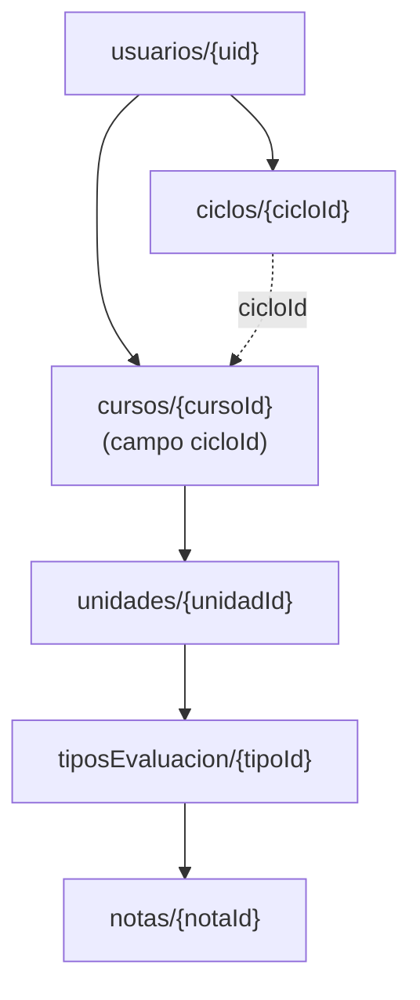

# Modelo de Datos Firestore

Este documento describe la estructura de datos que se utiliza en Pondera (PromedioApp) para guardar un historial académico completo (Ciclos -> Cursos -> Unidades -> Tipos de Evaluación -> Notas).

> **Nota importante sobre H07 (Cálculo rápido):**
> Esta estructura funciona de manera paralela a la función de "cálculo rápido" implementada en la H07. El cálculo rápido utiliza un modelo plano `ComponenteEvaluacion` guardado en `usuarios/{uid}/calculos/actual`. Ambas estructuras conviven: la de H07 es ideal para sacar un promedio veloz sin registrar un curso entero, mientras que la detallada aquí (H09) sirve para construir el expediente completo del estudiante.

## Estructura implementada

Los ciclos y los cursos son colecciones hermanas dentro del usuario. Cada curso guarda el `cicloId` al que pertenece, y los cursos de un ciclo se consultan con `where('cicloId', isEqualTo: ...)`. Desde el curso hacia abajo, los datos son subcolecciones anidadas.

Rutas completas:

| Nivel | Ruta |
| :--- | :--- |
| Ciclo | `usuarios/{uid}/ciclos/{cicloId}` |
| Curso | `usuarios/{uid}/cursos/{cursoId}` |
| Unidad | `usuarios/{uid}/cursos/{cursoId}/unidades/{unidadId}` |
| Tipo de evaluación | `usuarios/{uid}/cursos/{cursoId}/unidades/{unidadId}/tiposEvaluacion/{tipoId}` |
| Nota | `usuarios/{uid}/cursos/{cursoId}/unidades/{unidadId}/tiposEvaluacion/{tipoId}/notas/{notaId}` |

## Modelos de Datos

### Ciclo
| Campo | Tipo | Descripción |
| :--- | :--- | :--- |
| `id` | String | Identificador del documento |
| `nombre` | String | Nombre del ciclo (ej. "2026-II") |
| `fechaInicio` | String (ISO 8601) | Fecha de creación del ciclo; se usa para ordenar del más reciente al más antiguo |

### Curso
| Campo | Tipo | Descripción |
| :--- | :--- | :--- |
| `id` | String | Identificador del documento |
| `nombre` | String | Nombre del curso (ej. "Soluciones Móviles II") |
| `cicloId` | String | ID del ciclo al que pertenece |

### Unidad
| Campo | Tipo | Descripción |
| :--- | :--- | :--- |
| `id` | String | Identificador del documento |
| `nombre` | String | Nombre de la unidad (ej. "Unidad 1") |
| `cursoId` | String | ID del curso al que pertenece |
| `porcentaje` | double | Peso de la unidad en el curso (la suma en el curso debe ser 100%) |

### TipoEvaluacion
| Campo | Tipo | Descripción |
| :--- | :--- | :--- |
| `id` | String | Identificador del documento |
| `nombre` | String | Nombre (ej. "Examen Parcial", "Laboratorio") |
| `porcentaje` | double | Peso dentro de la unidad (la suma en la unidad debe ser 100%) |

### Nota
| Campo | Tipo | Descripción |
| :--- | :--- | :--- |
| `id` | String | Identificador del documento |
| `valor` | double | Valor de la nota obtenida (0 a 20) |
| `nombre` | String | Descripción opcional (ej. "Lab 4 · Widgets"); vacío si no se indicó |
| `fecha` | Timestamp | Fecha en la que se registró la nota |
| `tipoEvaluacionId` | String | ID del tipo de evaluación al que pertenece |

## Cálculo del promedio (H13 y H14)

1. **Promedio del tipo:** promedio simple de sus notas.
2. **Nota de la unidad:** suma de (promedio del tipo × peso del tipo / 100).
3. **Nota final del curso:** suma de (nota de la unidad × peso de la unidad / 100), redondeada a 1 decimal.

Si falta información (pesos que no suman 100% o tipos sin notas), no se muestra una nota final. En su lugar se muestra el **promedio parcial**: el promedio de lo ya evaluado, sin contar como 0 lo que aún no tiene notas, junto con el porcentaje del curso evaluado.
